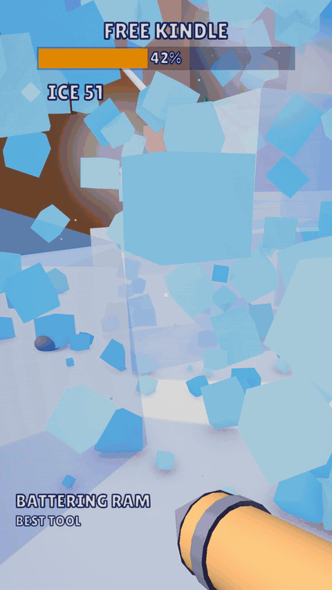
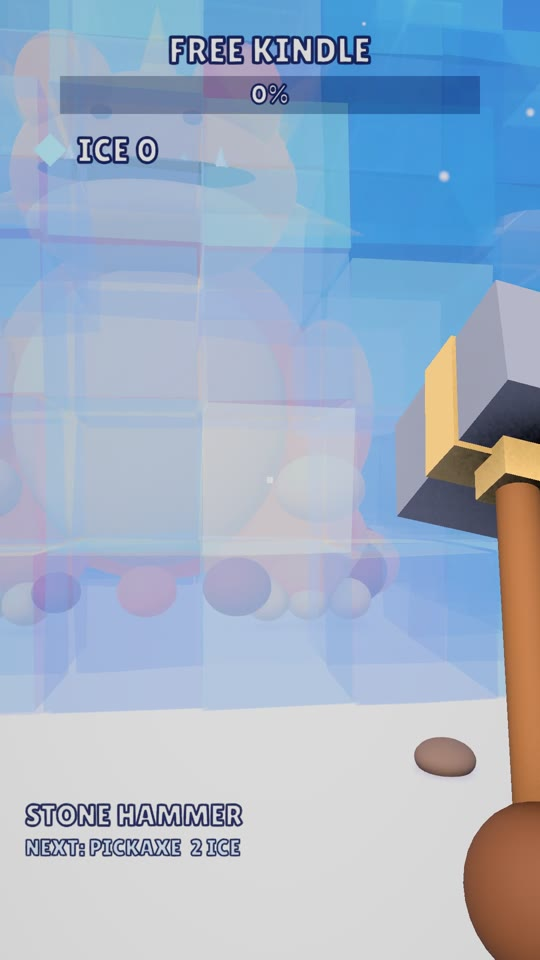
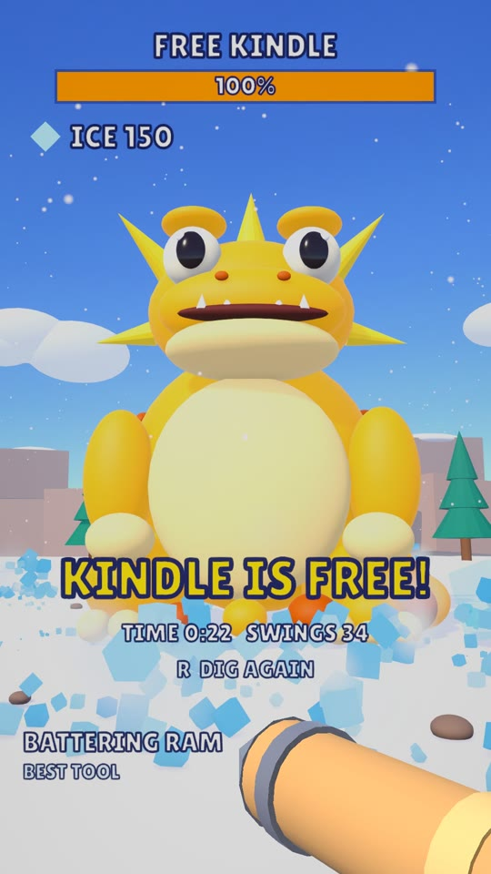

# Chisel Peak

**[▶ Play in browser](https://saturaspace.com/play/icedig/)**

A giant ember salamander is frozen inside a mountain of ice. Chip it out, one block at a time.

  
  

## How to play

- **Goal:** free Kindle, the salamander frozen in the ice dome. The bar at the top shows how close you are.
- **Mouse** look, **WASD** walk, **left click** (or Space) swing your tool.
- Every block you break gives you ice. Press **E** to craft the next tool when you have enough:
  Stone Hammer, Pickaxe (2 ice), Heavy Mallet (6), Battering Ram (14). Bigger tools break more blocks per hit.
- Dig low: ice that loses its support comes crashing down.
- **R** restarts.

## How to open it

1. Unity **6000.5.4f1** (Universal Render Pipeline, Input System).
2. Open the project folder in Unity Hub.
3. Open `Assets/ChiselPeak/ChiselPeak.unity` and press Play. The whole scene (ice, creature, snowfield, HUD) is built from code at start.

## Created by Satura Space

This game was made with [Satura Space](https://github.com/saturadev/satura-space) ([saturaspace.com](https://saturaspace.com)), a free and open-source app for building Unity games with AI agents.

A TikTok link was pasted into Satura Space (inspired by [@mana.games](https://www.tiktok.com/@mana.games/video/7705943118687784212)). A Claude agent watched the clip's frames, searched GitHub for how others solved the core mechanic (breaking a structure into chunks and dropping the parts that lose support), built the game in Unity from primitives, playtested it with a bot and filmed it. The name, the creature, the art and the code are its own.

## Model and cost

- Model: Claude Opus 5.5, in Claude Code.
- Estimated cost at Anthropic API list prices: **about $9.7 USD** for the whole run (one session, no subagents): 262 input tokens, 140.8k output tokens, 24.6M cache-read tokens and 245.6k cache-write tokens. This is an estimate at API prices, not a bill.

## Credits

- Collapse technique (anchored chunks flood-fill, unreached chunks fall) adapted from [ElasticSea/unity-fracture](https://github.com/ElasticSea/unity-fracture), MIT License. See `Assets/ThirdParty/CREDITS.md`.
- Font: [Lilita One](https://fonts.google.com/specimen/Lilita+One) by Juan Montoreano, SIL Open Font License 1.1.
- Inspired by a clip from [@mana.games](https://www.tiktok.com/@mana.games/video/7705943118687784212).

## License

MIT for the game's code and art, see [LICENSE](LICENSE). The font keeps its own OFL license.
